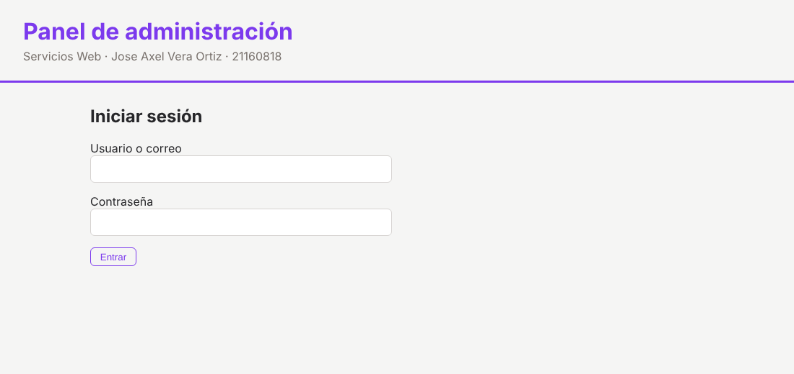
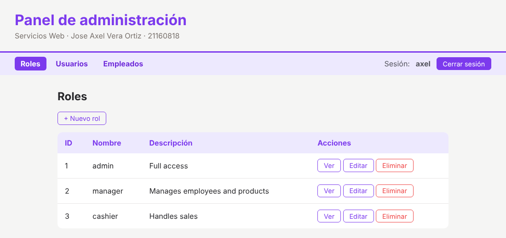

# Panel de administración · Login con JWT

Frontend en **Vue 3 + TypeScript** con **inicio de sesión** y **protección de rutas**. Consume el microservicio de [backend_for_students](https://github.com/BanderoChinoZF/backend_for_students/tree/BFS-0003) (rama `BFS-0003`): el backend valida la contraseña con **bcrypt** y devuelve un **token JWT**.

Parte del CRUD de roles, usuarios y empleados de la práctica anterior ([21160818_VeraOjoseA_frontend](https://github.com/AXEL00000000/21160818_VeraOjoseA_frontend)) y le agrega el login.

**Alumno:** Jose Axel Vera Ortiz · 21160818

**Materia:** Servicios Web · Instituto Tecnológico de Oaxaca

## Capturas

| Inicio de sesión | Sesión iniciada |
| :---: | :---: |
|  |  |

## Cómo funciona

| Paso | Qué pasa |
| --- | --- |
| Iniciar sesión | `POST /api/v1/auth/login` con usuario (o correo) y contraseña. El backend responde con el `accessToken`. |
| Guardar sesión | El token y el usuario se guardan en `localStorage`. |
| Cada petición | Un interceptor de axios agrega `Authorization: Bearer <token>` a todas las peticiones. |
| Protección de rutas | `router.beforeEach` manda a `/login` si no hay sesión, y de `/login` a `/roles` si ya la hay. |
| Token vencido o inválido | Si el backend responde **401**, se cierra la sesión y se regresa al login. |
| Cerrar sesión | El botón **Cerrar sesión** borra el token. |

Con la sesión iniciada se puede usar el CRUD de **roles, usuarios y empleados**.

## Archivos del login

```
src/
├── services/auth.service.ts   # login, logout, token e interceptores de axios
├── views/LoginView.vue        # pantalla de inicio de sesión
├── router/index.ts            # ruta /login y protección de rutas (beforeEach)
└── App.vue                    # menú con usuario y botón Cerrar sesión
```

## Cómo correrlo

Requiere Node.js 22.18 o más reciente.

1. Levantar el backend (`backend_for_students`, rama `BFS-0003`) en `http://localhost:3000`, con `JWT_SECRET` en su `.env` y un usuario con rol **admin**.
2. En este proyecto:

```sh
npm install
npm run dev
```

3. Abrir http://localhost:5173 e iniciar sesión.
